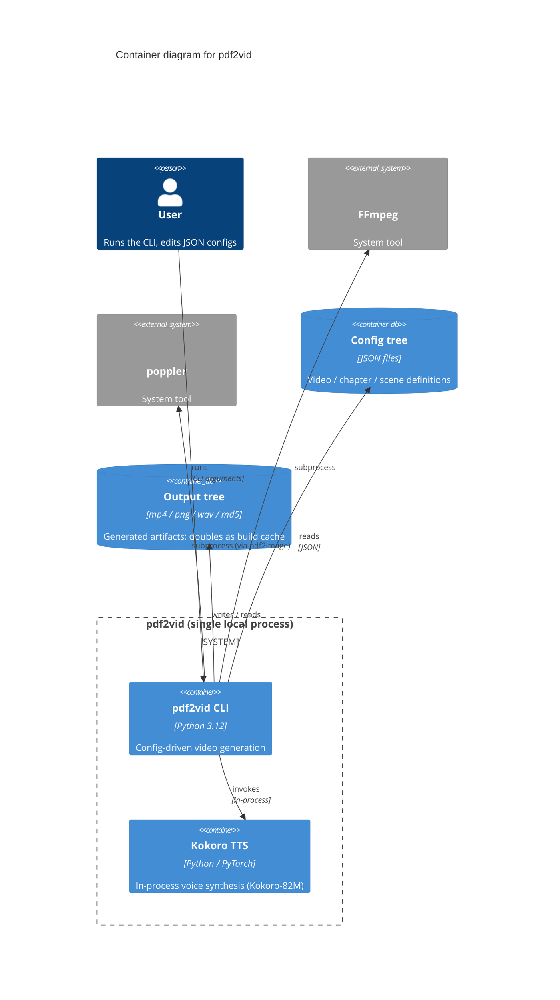
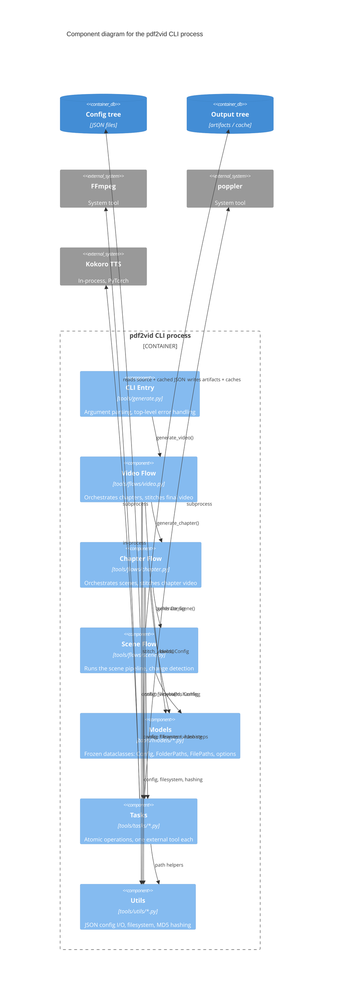
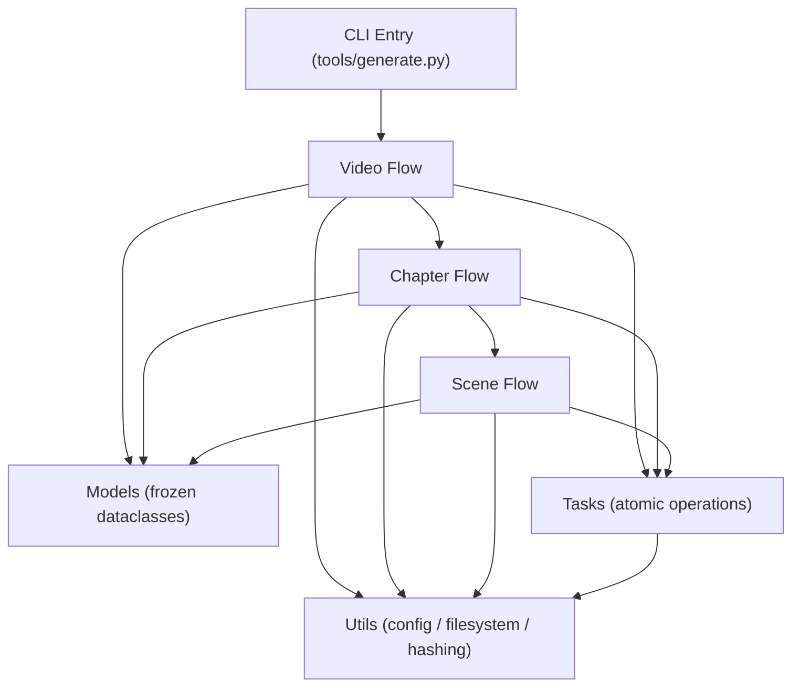
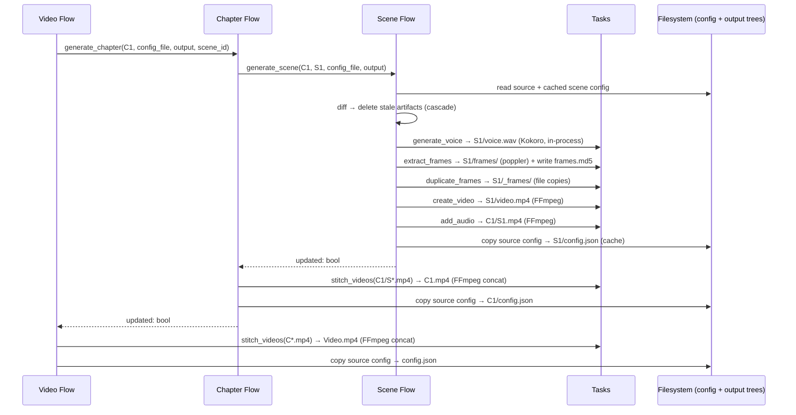
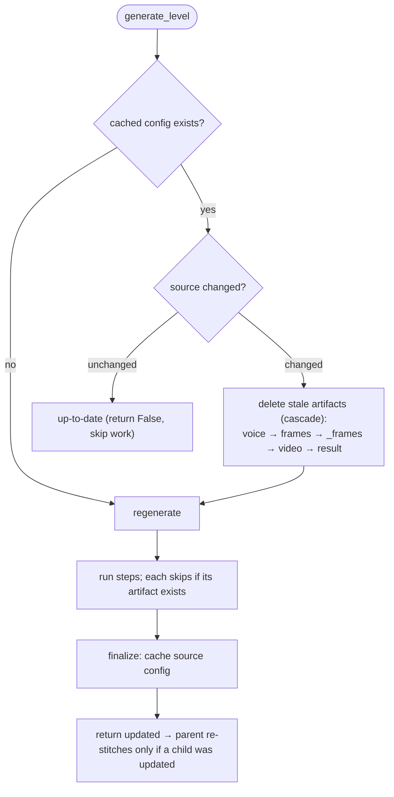

# Architecture — pdf2vid

Scope: config-driven, single-process CLI that turns a tree of JSON configs (video → chapter → scene) into a video: PDF pages become frames, local TTS produces the voice-over, FFmpeg assembles everything.

## Technology Stack

- **Language / runtime**: Python 3.12 (CPython), single CLI process — no server, daemon, or async runtime
- **Python dependencies** (`requirements.txt`):
  - `argparse` — argument parsing
  - `ffmpeg-python` — bindings to FFmpeg (encoding, muxing, concatenation)
  - `kokoro` — local text-to-speech engine (Kokoro-82M model; pulls in PyTorch)
  - `soundfile` — WAV output
  - `pdf2image` — PDF page rasterization
- **System tools** (invoked as subprocesses): FFmpeg, poppler (via `pdf2image`)
- **AI**: fully local — Kokoro-82M TTS runs in-process (voice `af_heart`, 24 kHz WAV); no cloud/API dependencies
- **Persistence**: none beyond the filesystem (JSON configs in, artifacts and caches out)

## System Architecture (C4 — Container)

- The entire system is **one local process**; everything else is a system tool or a file
- External media tools are subprocesses spawned via `ffmpeg-python` / `pdf2image`
- The output tree is dual-purpose: it holds the final video **and** serves as the build cache



## Application Architecture (C4 — Component)

- Four strictly layered component types inside the process: **flows** (orchestration), **tasks** (atomic operations), **models** (frozen data), **utils** (shared helpers)
- Flows form a recursive chain mirroring the content hierarchy: video → chapter → scene
- Tasks are the only components that touch external tools; each wraps exactly one of them
- `stitch_videos` is reused at both the chapter and video level (same concat, different inputs)



### Dependency layering



- Flows depend downward only (models, tasks, utils); **tasks never import flows**
- Tasks depend on at most one utility (`stitch_videos` → `filesystem.join_paths`)
- Models are pure data with no dependencies
- All flows also depend on the flow one level below (delegation), imported lazily inside functions

## Folder Structure and Responsibilities

```text
pdf2vid
├── pdf2vid                  # Executable entry script (python3 shebang) → imports tools.generate
├── requirements.txt         # Python dependencies
├── README.md                # Usage documentation
├── LICENCE
└── tools/                   # Application package (namespace package, no __init__.py)
    ├── generate.py          # CLI layer: argparse, top-level RuntimeError handling
    ├── flows/               # Orchestration layer — one module per hierarchy level
    │   ├── video.py         #   video flow: chapter orchestration, final stitch, finalize
    │   ├── chapter.py       #   chapter flow: scene orchestration, chapter stitch, finalize
    │   └── scene.py         #   scene flow: 5-step pipeline, change detection, finalize
    ├── models/              # Data layer — one module per hierarchy level
    │   ├── video.py         #   Config / FolderPaths / FilePaths (video level)
    │   ├── chapter.py       #   Config / FolderPaths / FilePaths (chapter level)
    │   └── scene.py         #   Config / FolderPaths / FilePaths / VoiceOptions / FrameOptions
    ├── tasks/               # Atomic operations — one module per operation
    │   ├── extract_frames.py      # PDF → PNG frames (pdf2image/poppler)
    │   ├── duplicate_frames.py    # insert duplicate frames (file copies)
    │   ├── create_video.py        # frames → video.mp4 (FFmpeg)
    │   ├── generate_voice.py      # text → voice.wav (Kokoro + soundfile)
    │   ├── add_audio.py           # video + voice → final scene mp4 (FFmpeg)
    │   └── stitch_videos.py       # concat scene/chapter videos (FFmpeg)
    └── utils/               # Shared stateless helpers
        ├── config.py        #   JSON config reading (None if missing)
        ├── filesystem.py    #   path join/parent, folder & file CRUD
        └── hashing.py       #   chunked MD5 file hashing (change detection)
```

- Naming is systematic: `flows/`, `models/`, `tasks/` carry **one module per concept** (`video`, `chapter`, `scene`, or one operation)
- `tools/` is a namespace package (no `__init__.py` files) resolved by running the entry script from the repo root

## Main Component Types and Their Interactions

### Component types (recurring shapes)

- **Flow module** (`flows/*`) — orchestration per hierarchy level
  - Template structure with section banners: `### DEFAULTS ###`, `### CONFIG ###`, `### INITIALIZE/PROCESS/GENERATE/FINALIZE ###`
  - One public entry point (`generate_video` / `generate_chapter` / `generate_scene`); all other helpers are `_`-prefixed
  - Builds a frozen `Config` (data + folder/file paths) from JSON, then: initialize (folders + change detection) → generate children or run pipeline → stitch → finalize (cache the config)
  - Returns an `updated` boolean consumed by the caller (propagates upward)
- **Task module** (`tasks/*`) — atomic operation
  - Exactly one public function, no state, no orchestration
  - Wraps one external tool (FFmpeg, poppler, Kokoro) or one plain file operation
  - Receives all paths as arguments — knows nothing about the output layout
- **Model module** (`models/*`) — frozen `@dataclass(frozen=True)` definitions
  - Per level: `Config` (semantic data + child references), `FolderPaths`, `FilePaths`
  - Scene level adds `VoiceOptions` and `FrameOptions`
  - `Config` is the single object threaded through all flow helpers
- **Utility module** (`utils/*`) — small stateless functions (JSON read, path/file ops, MD5 hashing)

### Interactions

- **Recursive delegation**: each flow resolves a child's relative config path against its own config folder and delegates to the flow one level below (lazy `from .chapter import …` / `from .scene import …` inside functions)
- **Scene pipeline** (fixed order; every step is a no-op when its artifact already exists):



- **Stitching is symmetric**: chapter flow concatenates `S*.mp4` → `C?.mp4`; video flow concatenates `C*.mp4` → `<Video>.mp4` — same `stitch_videos` task, different folder/inputs
- **Finalize is uniform**: every flow copies its source config to a cache `config.json` in its output folder — the baseline for the next run's change detection

### Change detection (incremental regeneration)

- No build system, no database — the **filesystem is the build state** (cached configs + artifacts + PDF hash)
- Each level diffs the cached config against the source:
  - **Video**: `chapters` mapping (chapter ID → config file) — a `dict[str, str]` whose insertion order is the render order
  - **Chapter**: `scenes` mapping (same shape)
  - **Scene**: `voice` (text/speed/delay) + `frames` (source/start/end/duplications/rate) fields, plus MD5 of the source PDF (`frames.md5`)
- Diff result drives **cascade invalidation** — only stale artifacts are deleted, so the exists-checks skip the rest:



- The `updated` flag propagates video ← chapter ← scene, so stitching only re-runs when something actually changed

## Important Architectural Decisions

- **Single-process, config-driven CLI** — the entire content model (video → chapter → scene) is declared in a tree of JSON files; each level is independently generatable (`--chapter`, `--scene`), not just the full video
- **Hierarchy mirrored everywhere** — the video/chapter/scene decomposition is repeated in the config tree, the flow modules, the model modules, and the output folder layout; each flow delegates to the one below (self-similar, uniform template)
- **Strict layering with one-way dependencies** — flows → tasks → utils, models as pure frozen data; tasks are dumb wrappers around exactly one external tool, keeping media-tool usage isolated and swappable
- **Filesystem as build state** — incremental builds via cached configs + artifact existence checks + MD5 source hashing instead of a build system or database; cheap re-runs, resumable generation
- **Cascade invalidation, skip-on-exists steps** — config diffing decides *what to delete*; each pipeline step then decides *what to do* by checking its own artifact; the two mechanisms compose so only the stale tail of the pipeline re-runs
- **Fully local media pipeline** — TTS (Kokoro-82M, in-process via PyTorch), rasterization (poppler), and video assembly (FFmpeg) are all local; no network services, no API keys
- **Lazy imports for heavy dependencies** — task and sub-flow imports happen inside functions, *after* artifact-existence checks, so PyTorch/Kokoro (and FFmpeg bindings) are only loaded when work will actually happen
- **Order-preserving config** — chapter and scene order is the JSON object's insertion order; `dict[str, str]` ID → relative config-file-path references resolved against the config file's folder
- **Minimal error handling by design** — flows raise `RuntimeError` for unknown/missing configs; the CLI entry catches and prints it (documented "works for us" internal-tool stance)
- **Script-style distribution** — no packaging (`pyproject`/`setup`) and no `__init__.py`; the extensionless `pdf2vid` script with a python3 shebang is the entry point, run from the repo root so the `tools` namespace package resolves
